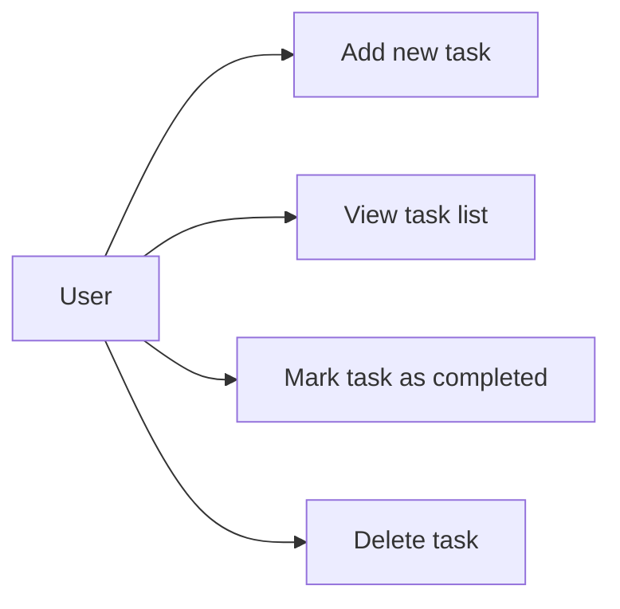
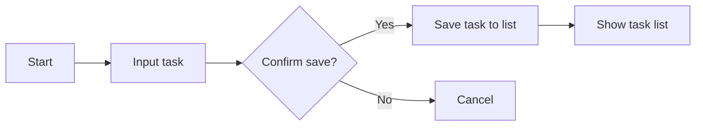

# Lightweight Task Management System

**Name:** Helen
**Student ID:** 202384014063

## Project Idea

A lightweight web-based task management system. Users can:

- Add to-do tasks
- View the task list
- Mark tasks as completed
- Delete tasks

## Technology Stack

- **Backend:** Python + Flask
- **Frontend:** HTML, CSS and JavaScript
- **Editor:** VS Code

## What Makes This Project Different

Most ready-made task management software includes many extra features and feels
heavy. This system focuses only on core to-do tracking. It is simple, lightweight,
and easy to run on a local computer.

## Current Prototype Status

The basic prototype is complete and runs locally. At this stage:

- Task data is stored in program memory.
- There is no user login system and no database.
- All data is lost when the Flask server restarts.

## How to Run

```bash
pip install -r requirements.txt
python app.py
```

Then open http://127.0.0.1:5000 in a browser.

On Windows you can also double-click `run.bat`.

## Project Structure

```
todo-app/
├── app.py              # Flask backend (routes + in-memory storage)
├── templates/
│   └── index.html      # Page structure
├── static/
│   ├── style.css       # Interface style
│   └── script.js       # Front-end logic (add / toggle / delete)
├── requirements.txt    # Python dependencies
├── run.bat             # One-click launcher for Windows
└── .gitignore          # Ignored files (__pycache__, venv, editor files)
```

## API Endpoints

| Method | Path                 | Purpose              |
| ------ | -------------------- | -------------------- |
| GET    | `/api/tasks`         | List every task      |
| POST   | `/api/tasks`         | Add a task           |
| PATCH  | `/api/tasks/<id>`    | Mark done / undone   |
| DELETE | `/api/tasks/<id>`    | Delete a task        |

## Diagrams

### Use Case Diagram



### Activity Diagram (add a task)



## Week 3 Progress & Tasks

- [x] Develop and improve webpage interface style with HTML and CSS in VS Code.
- [x] Complete Mermaid diagrams including use-case diagram and activity diagram.
- [x] Test all core functions manually: add tasks, mark tasks complete, delete tasks.
- [x] Complete and optimise this README.md document.
- [ ] Organise project files and upload the whole project to GitHub after testing passes.
